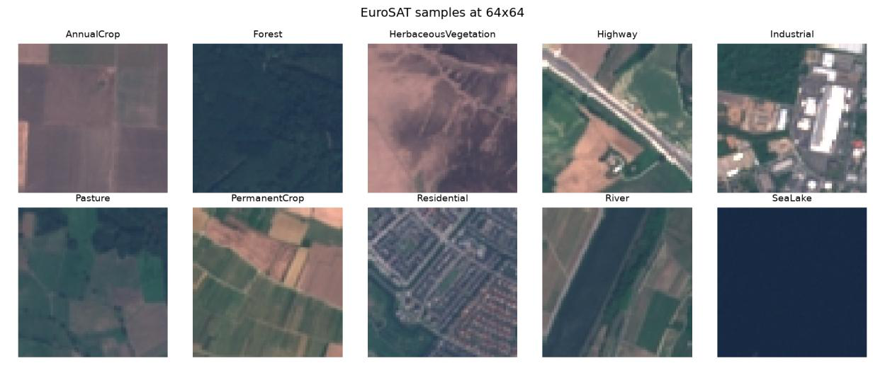
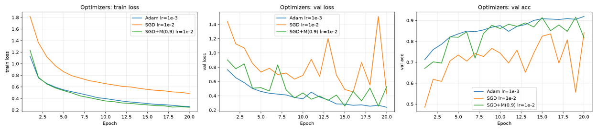
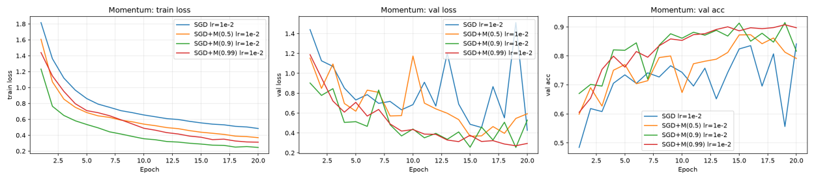
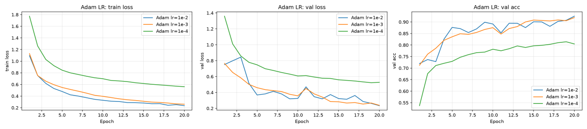
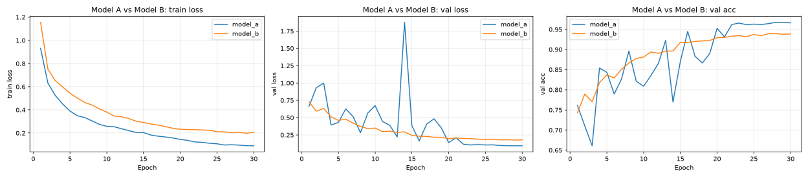
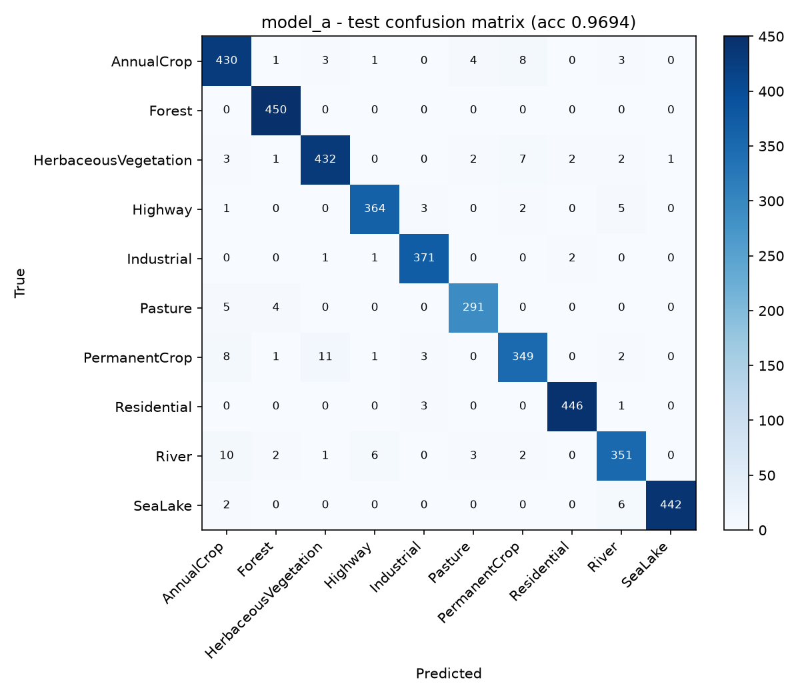
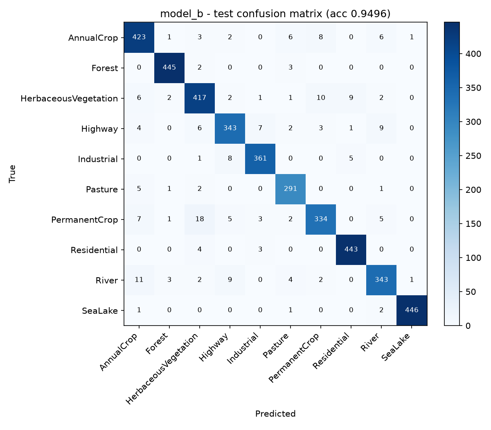
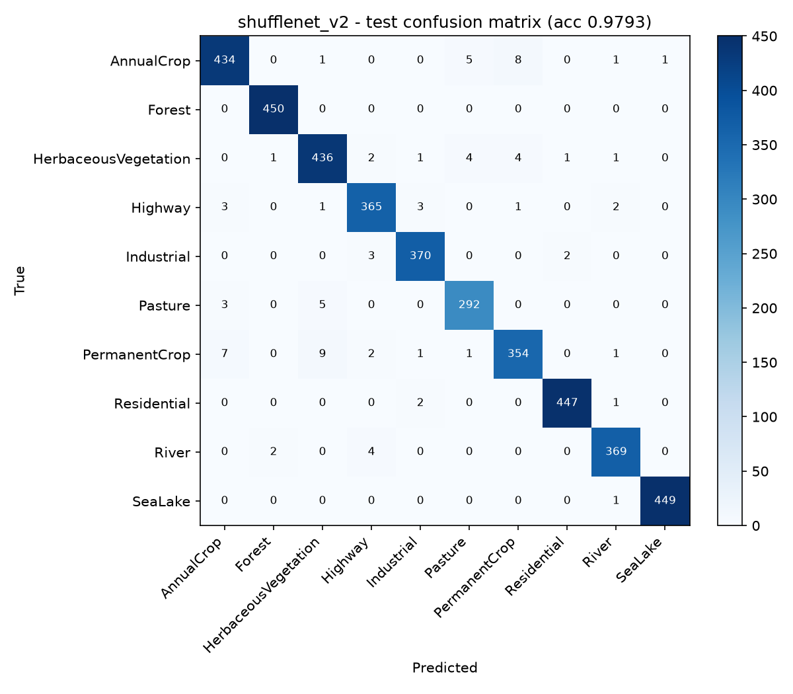
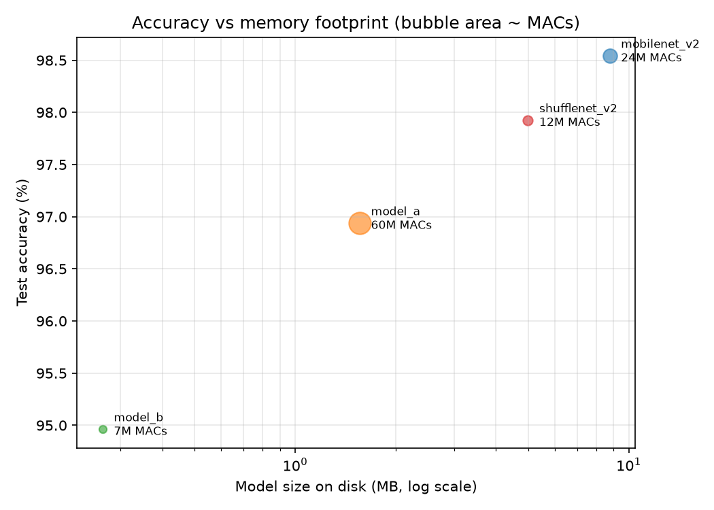

# EN3150 - Pattern Recognition
## Assignment 03: Resource-Constrained CNN for Edge Image Classification

**Group PatternX**

| Index number | Name |
|---|---|
| 220303E | Kariyawasam U.G.R.T. |
| 220370E | Maddumage M.M.T.D. |
| 220522A | Rathnayaka R.M.P.B. |
| 220525K | Rathnayake R.M.D.D. |

Repository: https://github.com/Parawork/Pattern
Dataset: EuroSAT (RGB), 27,000 images, 10 classes, 64x64

### Results at a glance

| | Params | Size | MACs | Test accuracy |
|---|---:|---:|---:|---:|
| Model A (standard CNN) | 405,994 | 1.56 MB | 60.18 M | 96.94% |
| Model B (lightweight CNN) | 63,659 | 265 KB | 7.33 M | 94.96% |
| ShuffleNetV2 x1.0 (fine-tuned) | 1,263,854 | 4.99 MB | 11.76 M | 97.93% |
| MobileNetV2 (fine-tuned) | 2,236,682 | 8.77 MB | 24.46 M | 98.54% |

---

# 1. Introduction and dataset

This report builds a lightweight image classifier for an embedded, low-resource target. We
design two CNNs from scratch - a standard one (Model A) and a depthwise-separable version
under 100,000 parameters (Model B) - choose and justify an optimizer, train and evaluate
both, and then compare the small model against two fine-tuned lightweight state-of-the-art
networks. Everything is implemented in PyTorch; the accompanying notebook reproduces every
number below.

### Why EuroSAT

We use **EuroSAT (RGB)**: 27,000 Sentinel-2 satellite patches covering 10 land-use classes
(AnnualCrop, Forest, HerbaceousVegetation, Highway, Industrial, Pasture, PermanentCrop,
Residential, River, SeaLake). CIFAR-10 is excluded by the assignment, and EuroSAT fits the
edge story better: it is exactly the problem a small satellite or drone faces when it has
to decide *on board* what it is looking at instead of transmitting every frame to the
ground. The images are natively **64x64 RGB**, which is the maximum resolution the
assignment allows, so we meet the constraint without discarding any information.

### Splits and pre-processing

| Split | Images | Fraction |
|---|---:|---:|
| Train | 18,900 | 70% |
| Validation | 4,050 | 15% |
| Test | 4,050 | 15% |
| **Total** | **27,000** | **100%** |

The split is **stratified** with a fixed seed (42) and the indices are written to
`data/splits.json`, so every model in this report - ours and the pre-trained ones - is
trained and evaluated on exactly the same images. Class balance is preserved in each split;
per class the training set holds between 1,400 (Pasture) and 2,100 (AnnualCrop, Forest,
HerbaceousVegetation, Residential, SeaLake) images.

Images are normalised with the ImageNet mean and standard deviation (required by the
pre-trained networks, harmless for ours, and it keeps the comparison exact). Augmentation is
applied to the training split only: random horizontal and vertical flips and random 90-degree
rotations. Satellite imagery has no canonical orientation, so these transforms are
label-preserving and cost essentially nothing to compute.

---
# 2. Custom architecture design

Both models share the **same skeleton** and differ only in the convolution block, which is
deliberate: any difference in parameters, MACs, latency or accuracy is then attributable to
the depthwise separable factorisation and to nothing else.

| Stage | Model A (standard CNN) | Model B (lightweight CNN) |
|---|---|---|
| Block, x4 | Conv 3x3 -> BN -> ReLU | DWConv 3x3 -> BN -> ReLU -> PWConv 1x1 -> BN -> ReLU |
| Downsampling | MaxPool 2x2 after each block | MaxPool 2x2 after each block |
| Channels | 3 -> 32 -> 64 -> 128 -> 256 | 3 -> 32 -> 64 -> 128 -> 256 |
| Spatial size | 64 -> 32 -> 16 -> 8 -> 4 | 64 -> 32 -> 16 -> 8 -> 4 |
| Head | GAP -> FC 64 -> ReLU -> Dropout 0.3 -> FC 10 | identical |

All 3x3 convolutions use stride 1 and padding 1, so only the max-pools change the spatial
size. Convolutions carry no bias because the following BatchNorm supplies its own shift.
BatchNorm contributes 2 trainable parameters per channel.

### Parameter and MAC calculation

With `k` the kernel size, `Cin`/`Cout` the channel counts and `HxW` the output size of the
convolution: a standard conv costs `k^2.Cin.Cout` parameters and `H.W.k^2.Cin.Cout` MACs; a
depthwise conv `k^2.Cin` and `H.W.k^2.Cin`; a pointwise conv `Cin.Cout` and `H.W.Cin.Cout`;
a fully connected layer `in.out + out` parameters and `in.out` MACs.

### Model A - standard CNN

| # | Layer | Kernel / units | Output | Weights | BN | Params | MACs |
|---|---|---|---|---:|---:|---:|---:|
| 1 | Conv + BN + ReLU | 3x3, 3->32 | 64x64x32 | 864 | 64 | 928 | 3,538,944 |
| 2 | Conv + BN + ReLU | 3x3, 32->64 | 32x32x64 | 18,432 | 128 | 18,560 | 18,874,368 |
| 3 | Conv + BN + ReLU | 3x3, 64->128 | 16x16x128 | 73,728 | 256 | 73,984 | 18,874,368 |
| 4 | Conv + BN + ReLU | 3x3, 128->256 | 8x8x256 | 294,912 | 512 | 295,424 | 18,874,368 |
| 5 | Global average pool | - | 256 | - | - | 0 | - |
| 6 | FC + ReLU + Dropout | 64 units | 64 | 16,384 | - | 16,448 | 16,384 |
| 7 | FC (logits) | 10 units | 10 | 640 | - | 650 | 640 |
|  | **Total** |  |  |  |  | **405,994** | **60.18 M** |

### Model B - lightweight CNN (depthwise separable)

| # | Block | DW weights | DW BN | PW weights | PW BN | Params | MACs |
|---|---|---:|---:|---:|---:|---:|---:|
| 1 | 3->32 @ 64x64 | 27 | 6 | 96 | 64 | 193 | 503,808 |
| 2 | 32->64 @ 32x32 | 288 | 64 | 2,048 | 128 | 2,528 | 2,392,064 |
| 3 | 64->128 @ 16x16 | 576 | 128 | 8,192 | 256 | 9,152 | 2,244,608 |
| 4 | 128->256 @ 8x8 | 1,152 | 256 | 32,768 | 512 | 34,688 | 2,170,880 |
| 5 | GAP -> FC 64 + ReLU + Dropout | - | - | - | - | 16,448 | 16,384 |
| 6 | FC 10 (logits) | - | - | - | - | 650 | 640 |
|  | **Total** |  |  |  |  | **63,659** | **7.33 M** |

**Model B uses 63,659 trainable parameters, within the 100,000 budget** - 6.4x fewer than
Model A, with 8.2x fewer MACs. These hand calculations are asserted against PyTorch's own
counts in the notebook, so the two can never silently diverge.

For a single layer, a depthwise separable convolution costs `1/Cout + 1/k^2` of a standard
one. With `k = 3` and `Cout = 256` that is `1/256 + 1/9 = 0.115`, about 8.7x cheaper. The
first block is depthwise separable too, as required; with only 3 input channels it saves
little (193 parameters instead of 928), which is precisely why MobileNet keeps a standard
first convolution.

Weight storage: Model A is about 1.55 MB in float32 (0.39 MB in int8); Model B is about
249 KB in float32 and **62 KB in int8** - small enough for a microcontroller with 256 KB of
flash once quantised.

### Hardware-aware justification of the design choices

- **ReLU everywhere.** `max(0, x)` is one comparison: no exponential, no division, no lookup table. Sigmoid, tanh, Swish and GELU all need `exp()`, which is slow or software-emulated on microcontrollers and DSPs without an FPU. ReLU also maps exactly onto int8 arithmetic - zero stays zero and nothing needs re-scaling - and it can be fused into the conv/BN kernel. Its gradient does not saturate, so it also trains faster. ReLU6 would be a reasonable alternative because its bounded range makes int8 quantisation easier.
- **No softmax at inference.** Softmax, the only exponential in the network, is used solely inside the cross-entropy loss during training. On the device the prediction is the `argmax` of the logits, which gives the same answer at no extra cost.
- **BatchNorm is free at inference.** After training it folds into the preceding convolution's weights and bias, so it costs nothing on the device while still stabilising training.
- **Global average pooling instead of Flatten.** Flatten would produce a 4x4x256 = 4,096-wide vector and a 64-unit FC layer on top of it would need 262k weights - Model B would exceed its budget in the classifier alone. GAP needs only 256 inputs.
- **Max-pooling** involves comparisons only, no multiplications, and it reduces the activation memory (RAM) the next layer needs - usually the binding constraint on a microcontroller, more so than flash.
- **Channel widths 32-64-128-256** are multiples of 8 and 16, which map cleanly onto SIMD lanes and NPU tile sizes.

---
# 3. Optimizer selection and tuning

The study is run on **Model B**, the model we actually intend to deploy. To keep the
comparison fair, every run starts from the *same* initial weights and sees the mini-batches
in the same order; the only variable is the optimizer. All runs are 20 epochs.

| Run | Best val acc | Test acc | Final val loss | Val-loss sigma (last 5) | Epochs to 85% val acc |
|---|---:|---:|---:|---:|---:|
| Adam lr=1e-2 | 0.9249 | 0.9365 | 0.2341 | 0.0439 | 5 |
| **Adam lr=1e-3 (chosen)** | 0.9190 | 0.9259 | 0.2385 | **0.0124** | 8 |
| Adam lr=1e-4 | 0.8141 | 0.8249 | 0.5274 | 0.0108 | never |
| SGD lr=1e-2 | 0.8417 | 0.8568 | 0.4266 | 0.4056 | never |
| SGD + momentum 0.5, lr=1e-2 | 0.8731 | 0.8719 | 0.5935 | 0.0851 | 15 |
| SGD + momentum 0.9, lr=1e-2 | 0.9151 | 0.9210 | 0.5292 | 0.1067 | 9 |
| SGD + momentum 0.99, lr=1e-2 | 0.9077 | 0.9240 | 0.2945 | 0.0183 | 9 |

### Our choice and why

We train with **Adam, learning rate 1e-3, weight decay 1e-4 and cosine decay**. Adam's
per-parameter adaptive step sizes matter for Model B in particular because its layers are
very uneven: a depthwise layer holds 9 weights per channel while the pointwise layer beside
it holds hundreds, and a single global step size suits neither. Adam normalises each
parameter's step by a running estimate of its gradient magnitude, so both layer types make
progress at the same time.

The learning rate was chosen from the sweep rather than by default. At 1e-2 Adam reached
85% validation accuracy three epochs sooner, but its validation loss in the last five epochs
was 3.5x noisier (sigma = 0.044 against 0.012) - it was bouncing around the minimum rather
than settling in it. At 1e-4 the training was very smooth but had not converged after 20
epochs (81.4% best validation accuracy, never reaching the 85% target). **1e-3 is where
convergence speed and stability meet**, and the cosine schedule shrinks the step towards the
end so the final epochs settle into the minimum rather than oscillate around it.

### Comparison against SGD and SGD with momentum

**Plain SGD is the weakest of the seven runs.** At lr = 1e-2 the raw gradient step is too
small to cross the shallow, noisy regions of the loss surface: it never reaches 85%
validation accuracy within 20 epochs, finishes at 84.2% best validation accuracy
(85.7% test), and its validation loss oscillates badly - a standard deviation of 0.41 over
the last five epochs, more than 30x Adam's. Every mini-batch pulls the weights in a slightly
different direction and nothing averages that noise out.

### The impact of the momentum parameter

Momentum accumulates an exponentially-weighted average of past gradients,
`v <- beta.v + g`, and steps along `v` instead of along `g`. Along directions where the
gradient keeps the same sign the updates reinforce each other, amplifying the effective step
by roughly `1/(1 - beta)`; in directions where the gradient flips sign from batch to batch
they cancel, which damps the oscillation. The measured effect:

- **beta = 0.5** (about 2x the effective step): clearly better than plain SGD - 87.3% best validation accuracy and 85% reached at epoch 15 - but still slow, and its final validation loss is the highest of all runs (0.59), so 20 epochs is not enough for it to converge.
- **beta = 0.9** (about 10x): the sweet spot. 91.5% best validation accuracy and 92.1% test accuracy, reaching 85% at epoch 9. This is essentially Adam's convergence speed and accuracy from a plain first-order method.
- **beta = 0.99** (about 100x): **no faster** to the target (also epoch 9) and slightly *lower* best validation accuracy (90.8%), although its late-training loss was the smoothest of the SGD runs (sigma = 0.018) because the long averaging window suppresses almost all mini-batch noise. That same long window makes the update slow to respond to changes in curvature: the accumulated velocity carries the weights past narrow valleys and several epochs are needed to turn around. This is the classic momentum trade-off - acceleration against responsiveness - and it shows that increasing beta does not monotonically improve convergence.

**Conclusion.** Momentum closes most of the gap between SGD and Adam: test accuracy rises
from 85.7% (plain SGD) to 92.1% at beta = 0.9, within 1.5 points of our chosen
configuration. But it requires beta to be tuned - 0.5 is too slow, 0.99 overshoots - while
Adam reached the same place with its default settings and a single learning-rate sweep.
Since the optimizer exists only during training, this choice costs nothing on the device.

---
# 4. Custom model training and evaluation

Both models are trained with the configuration chosen in Section 3 - Adam, lr 1e-3, weight
decay 1e-4, cosine decay - for **30 epochs** (the assignment requires at least 20), with the
same data, seed and schedule. The weights from the best validation epoch are kept and used
for all test-set metrics.

### Test-set results and comparison

| Model | Params | MACs (M) | Size on disk (KB) | Train time / epoch (s) | CPU latency (ms) | Test acc | Precision | Recall |
|---|---:|---:|---:|---:|---:|---:|---:|---:|
| Model A | 405,994 | 60.18 | 1,598.7 | 5.25 | 4.87 | 0.9694 | 0.9690 | 0.9686 |
| Model B | 63,659 | 7.33 | 270.9 | 5.41 | 3.94 | 0.9496 | 0.9486 | 0.9484 |

Precision and recall are macro-averaged over the 10 classes. Size on disk is the float32
`state_dict` file. CPU latency is the median single-image (batch 1) forward pass on one CPU
thread, our proxy for a small edge processor. Training time per epoch is measured on the GPU
and excludes validation.

### Discussion: trade-offs of depthwise separable convolutions

**What was bought and what was paid.** Model B is **6.4x smaller in parameters, 8.2x cheaper
in MACs and 5.9x smaller on disk**, and it costs **1.98 percentage points** of test accuracy
(96.94% to 94.96%). On an edge budget this is a good bargain: 271 KB of float32 weights, or
about 62 KB quantised to int8, fits a microcontroller with 256 KB of flash, whereas Model A's
1.6 MB does not fit at all.

**The timing result deserves attention.** Model B's training time per epoch did **not** fall
with its MAC count - it was marginally *slower* (5.41 s against 5.25 s). Depthwise
convolutions are memory-bandwidth bound rather than compute bound: a 3x3 depthwise filter
performs 9 MACs per loaded activation, whereas a dense convolution with 256 output channels
reuses each loaded value hundreds of times. A GPU with thousands of idle arithmetic units
gains nothing from fewer MACs when the bottleneck is fetching activations from memory, and
the extra kernel launches - two convolutions and two BatchNorms per block instead of one
each - add overhead of their own. The MAC reduction does show up where arithmetic is the
genuine constraint: single-threaded CPU latency improved from 4.87 ms to 3.94 ms, a 1.24x
speed-up. The practical lesson is that **MACs predict energy and memory traffic, not
wall-clock time**; the benefit depends entirely on the target hardware, and must be measured
on it.

**Where the errors are.** Both models fail in the same, interpretable places. The largest
single confusion for both is **PermanentCrop misread as HerbaceousVegetation** (11 images for
Model A, 18 for Model B): seen from directly overhead, an orchard and rough grassland are
both green textured fields, differing mainly in the regularity of the planting - a
fine-grained cue that is already marginal at 64x64. **River misread as AnnualCrop** (10 and
11) is the same problem: a narrow waterway crossing farmland occupies only a handful of
pixels in a 64x64 patch. Model B additionally confuses **Highway with River** (9 images);
both are long thin ribbons crossing the scene, and separating them needs texture and colour
detail that the thinner network has less capacity to encode. PermanentCrop has the worst
recall in both models (0.931 for A, 0.891 for B).

Crucially, the accuracy gap between A and B is **concentrated in these ambiguous vegetation
and linear-feature classes**. The visually distinctive classes - Forest, SeaLake, Residential,
Industrial - stay above 0.97 recall even in the 64k-parameter model. A small model does not
degrade uniformly; it loses exactly the fine-grained discriminations that need surplus
capacity, which is useful to know when deciding whether a given deployment can tolerate it.

---
# 5. Fine-tuning lightweight state-of-the-art networks

We chose **MobileNetV2** and **ShuffleNetV2 x1.0**. Both were designed for phones and
embedded targets, both are parameter-efficient by construction - MobileNetV2 through
inverted residual blocks with depthwise separable convolutions, ShuffleNetV2 through channel
split and channel shuffle - and both ship with ImageNet weights in torchvision.

**Fine-tuning procedure.** The 1000-class head is replaced with a 10-class linear layer and
the whole network is then trained with two learning rates: a gentle `1e-4` for the
pre-trained backbone, so the ImageNet features are nudged rather than erased, and `1e-3`
(ten times larger) for the randomly initialised head. Optimizer AdamW, weight decay 1e-4,
cosine decay, 20 epochs. Both models use the **same 64x64 splits** as our custom networks,
so the comparison is exact - even though these architectures were designed for 224x224 input
and are therefore somewhat handicapped by the small images.

| Model | Params | MACs (M) | Size (MB) | Train time / epoch (s) | CPU latency (ms) | Test acc | Precision | Recall |
|---|---:|---:|---:|---:|---:|---:|---:|---:|
| ShuffleNetV2 x1.0 | 1,263,854 | 11.76 | 4.99 | 11.45 | 7.22 | 0.9793 | 0.9785 | 0.9786 |
| MobileNetV2 | 2,236,682 | 24.46 | 8.77 | 10.11 | 7.04 | 0.9854 | 0.9850 | 0.9846 |

Both converge in 20 epochs rather than the 30 our models needed: ImageNet features for
edges, textures and colour statistics transfer directly to satellite imagery, so fine-tuning
only has to re-weight them. MobileNetV2 is the more accurate of the two (98.54%) while
ShuffleNetV2 is the more efficient (1.3 M parameters and 11.8 M MACs for 97.93%).

Their remaining errors are the same vegetation ambiguities our models hit - MobileNetV2's
largest confusions are AnnualCrop to PermanentCrop and Pasture to AnnualCrop, 7 images each.
That these errors persist in a 2.2 M-parameter pre-trained network suggests they are close
to the limit of what a 64x64 patch supports, rather than a capacity problem.

---
# 6. Final comparison and trade-off discussion

| Model | Params | Size | MACs (M) | CPU latency (ms) | Epochs | Test acc |
|---|---:|---:|---:|---:|---:|---:|
| **Model B (ours)** | **63,659** | **265 KB** | **7.33** | **3.94** | 30 | 0.9496 |
| ShuffleNetV2 x1.0 | 1,263,854 | 4.99 MB | 11.76 | 7.22 | 20 | 0.9793 |
| MobileNetV2 | 2,236,682 | 8.77 MB | 24.46 | 7.04 | 20 | 0.9854 |

### Accuracy

MobileNetV2 beats Model B by **3.58 points** and ShuffleNetV2 by **2.97**. Almost all of
that gap comes from **ImageNet pre-training rather than architecture**: MobileNetV2 is itself
built from depthwise separable convolutions, so the operations are fundamentally the same -
it simply begins from features learned on a million photographs, while Model B learns
everything from 18,900 satellite patches. Depth and width contribute as well (MobileNetV2 is
53 layers against our 8), but the transfer-learning head start is the dominant term, and it
also explains why the pre-trained models converge in 20 epochs where ours needed 30.

### Memory footprint

This is where the custom model wins outright, and not marginally: **Model B is 35x smaller
than MobileNetV2 and 19x smaller than ShuffleNetV2**. On a microcontroller the distinction is
categorical rather than incremental. An STM32-class device with 256 KB to 1 MB of flash can
hold int8 Model B (about 62 KB) with room to spare for the application code; int8
MobileNetV2 (about 2.2 MB) does not fit at all, at any accuracy. Activation RAM follows the
same pattern: Model B's largest intermediate tensor is 64x64x32 = 128 KB in int8, which is
already demanding for such a device, and MobileNetV2's is several times larger. The honest
comparison on that class of hardware is therefore not "95% against 98.5%" but **"95% against
nothing runs at all"**.

### Computational cost

Model B needs **3.3x fewer MACs than MobileNetV2** and 1.6x fewer than ShuffleNetV2, and was
**1.8x faster** in single-threaded CPU inference (3.94 ms against about 7 ms). Fewer MACs and
a smaller working set also mean less energy per inference, which on a battery- or
solar-powered sensor directly determines the achievable duty cycle - how often the device can
afford to classify. The caveat from Section 4 applies here too: the MAC advantage produced a
real speed-up on the CPU but none on the GPU, because depthwise convolutions are memory-bound.
On any specific target the figures must be measured, not extrapolated from MAC counts.

### Advantages of a custom sub-100k model

- **Full control of the footprint.** We could fix the budget first and design to it, which is how embedded work actually proceeds - the device's flash and RAM are given, and the model must fit them.
- **No dependency on pre-trained weights**, their licences, or their provenance.
- **An architecture matched to the real input resolution.** MobileNetV2 downsamples by a factor of 32, so at 64x64 input its final feature map is a degenerate 2x2 and much of its depth is wasted. Our models downsample by 16 to a 4x4 map, which suits the data.
- **Auditable and deployable.** A model this small and simple can be inspected layer by layer, quantised, and run on a minimal runtime without an operator zoo.

### Limitations

We paid about 3.6 accuracy points, needed 30 epochs instead of 20, and spent considerably
more engineering effort: the architecture, the parameter budget and the optimizer all had to
be worked out by hand, whereas fine-tuning MobileNetV2 is a dozen lines of torchvision. A
sub-100k model trained on 18,900 images is also **more exposed to distribution shift** - it
holds far less redundant capacity, so a new sensor, season or geography is more likely to
degrade it than a model whose features were learned on ImageNet. And as Section 4 showed, its
errors are concentrated in the fine-grained classes, so a deployment that specifically needs
PermanentCrop separated from HerbaceousVegetation would be poorly served by it.

### Recommendation

The decision follows the **memory budget, not the accuracy table**. Below roughly 1 MB of
flash - microcontrollers and deeply embedded sensors - Model B is the only option here that
fits at all, and 94.96% accuracy is a usable classifier. With a few megabytes to spare and a
Linux-class edge device such as a Raspberry Pi or Jetson, fine-tuned MobileNetV2 is the
better buy: 3.58 points of accuracy for 8.5 MB is cheap when the memory exists, and the
engineering cost is far lower. The middle ground - ShuffleNetV2, or an int8-quantised
MobileNetV2 at about 2.2 MB - is worth measuring whenever the target sits between those
extremes.

The broader conclusion is that on edge hardware accuracy is a **constrained optimisation**:
the device fixes the memory and energy budget first, and the best model is simply the most
accurate one that fits inside it.

# 7. Reproducing these results

The submitted notebook `PatternX_A03_EN3150.ipynb` is self-contained and reproduces every
table and figure in this report when run top to bottom (about 1 to 1.5 hours on an
RTX 3060 Ti; set `QUICK = True` for a 2-epoch smoke test). The full repository, with the
pipeline split into numbered scripts and the commit history for this assignment, is at
**https://github.com/Parawork/Pattern**.

Seed 42 is set before every model build and training run, and `data/splits.json` pins the
train/validation/test indices, so all four models are evaluated on identical images. The
reported figures were produced on an NVIDIA RTX 3060 Ti with PyTorch 2.x; minor run-to-run
variation is expected from cuDNN's non-deterministic kernel selection. Training times per
epoch are GPU measurements excluding validation, and CPU latency is measured with
`torch.set_num_threads(1)` on the same machine.
